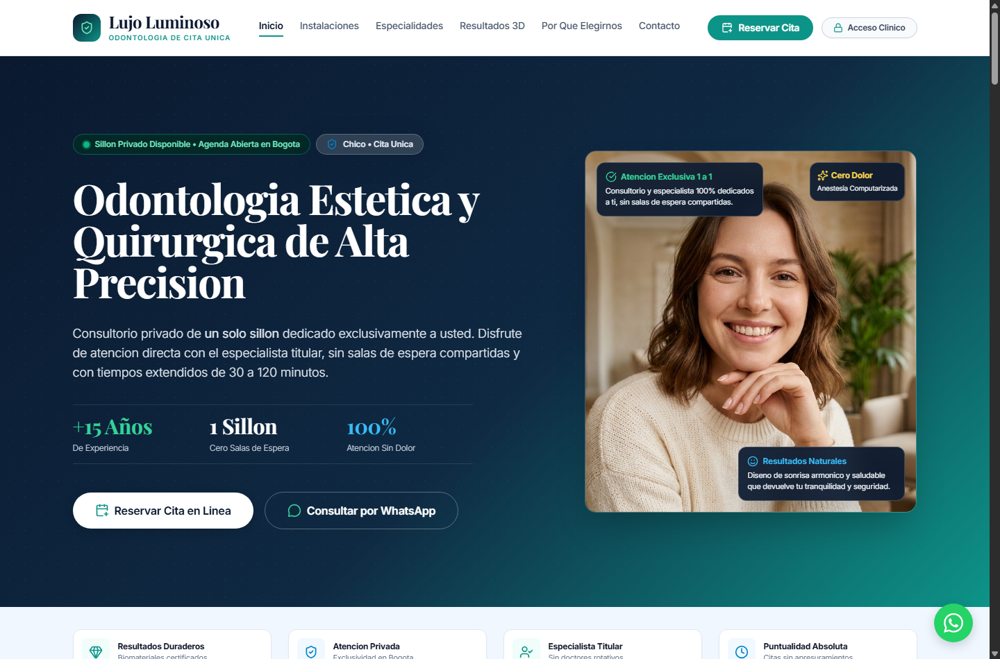
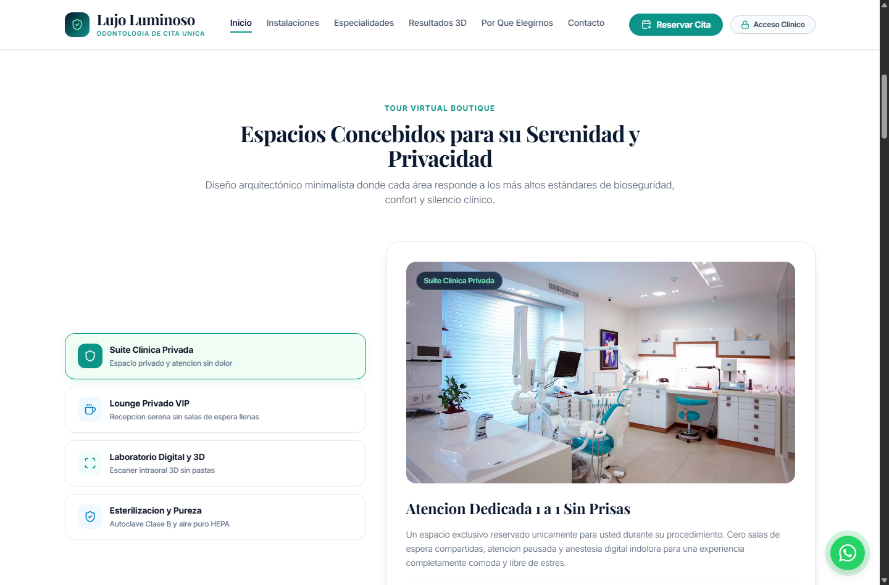
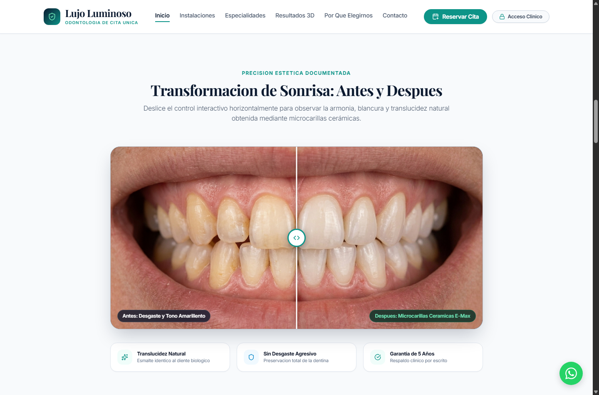
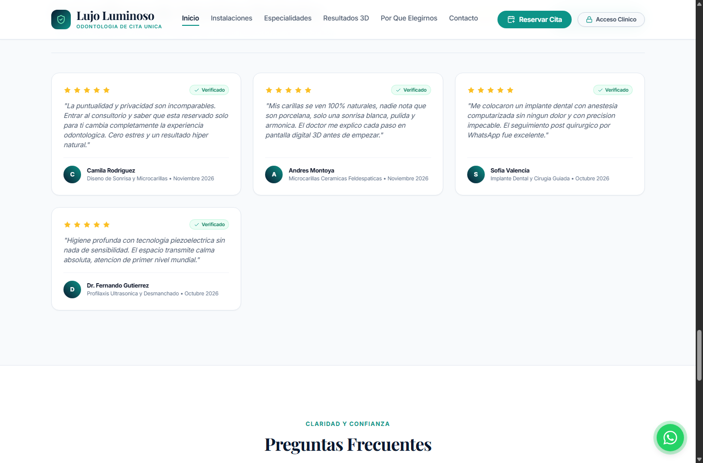
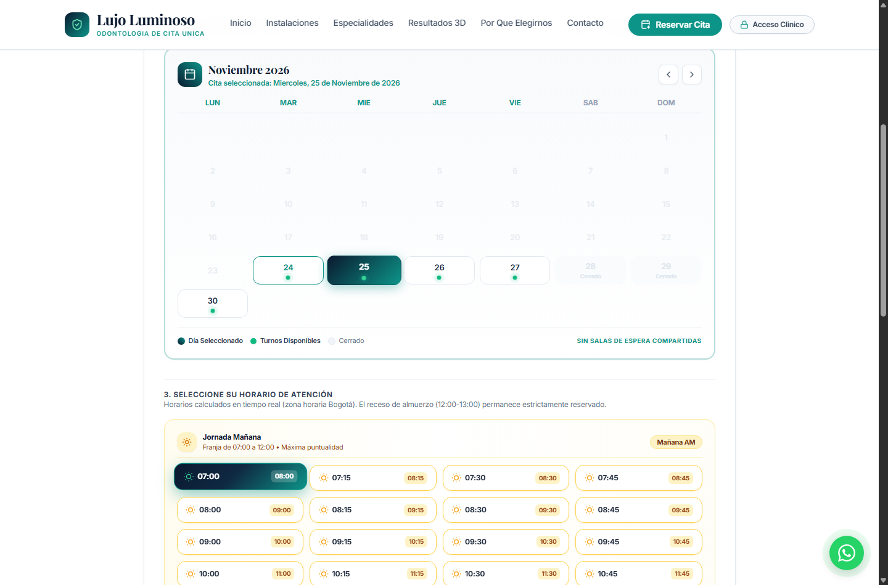
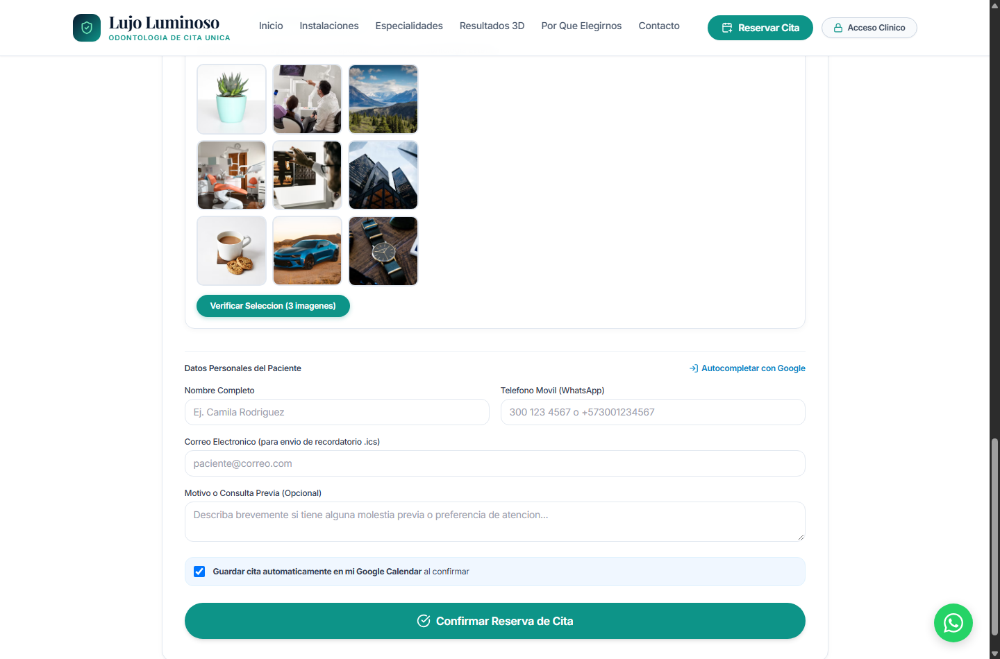
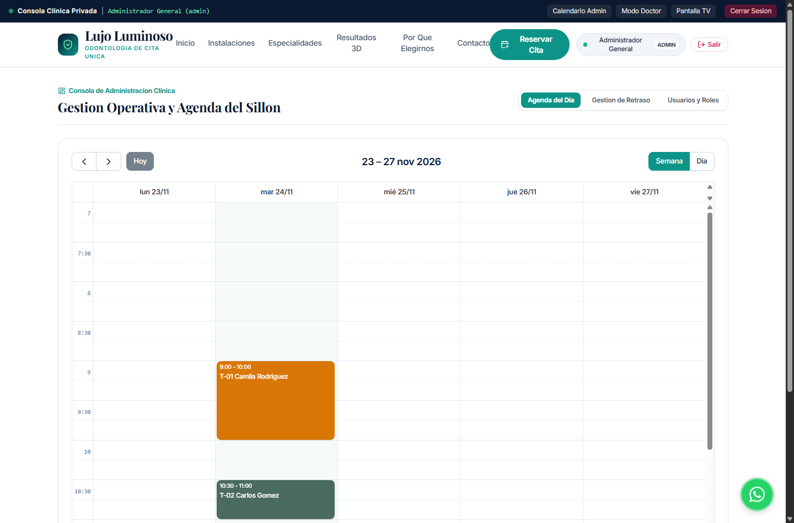
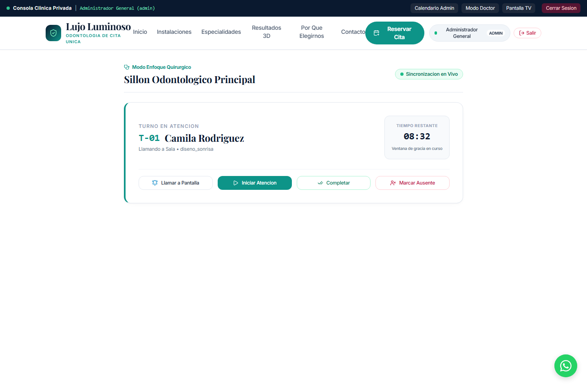
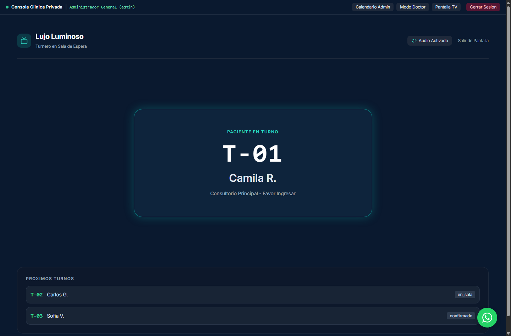

# Clinica Odontologica Boutique "Lujo Luminoso" — Sistema Integral de Agendamiento, Operacion Clinica y Bot WhatsApp IA

Plataforma web y conversacional omnicanal diseñada exclusivamente para consultorios odontologicos boutique de **un solo doctor y un solo sillon clinico** (`1 Doctor, 1 Sillon`, zona horaria `America/Bogota`). Combina una experiencia publica de alta gama para pacientes, portal de reservas en tiempo real con CAPTCHA propio y Google Calendar, bot de WhatsApp con Inteligencia Artificial (Google Gemini + Function Calling), consola operativa con FullCalendar v6, modo enfoque quirurgico para el doctor y pantalla Smart TV para sala de espera.

---

## Tabla de Contenidos

1. [Galeria Visual del Sistema en Ejecucion](#1-galeria-visual-del-sistema-en-ejecucion)
2. [Catalogo Completo de Capacidades y Modulos](#2-catalogo-completo-de-capacidades-y-modulos)
3. [Reglas Clinicas Inmutables y Motor Matematico](#3-reglas-clinicas-inmutables-y-motor-matematico)
4. [Arquitectura Tecnica y Estructura del Repositorio](#4-arquitectura-tecnica-y-estructura-del-repositorio)
5. [Seguridad Perimetral y Auditoria (10 Controles)](#5-seguridad-perimetral-y-auditoria-10-controles)
6. [Guia de Instalacion y Configuracion](#6-guia-de-instalacion-y-configuracion)
7. [Despliegue en Produccion (Docker + Cloudflare Tunnel + Meta Webhook)](#7-despliegue-en-produccion-docker--cloudflare-tunnel--meta-webhook)
8. [Pruebas Automatizadas y Verificacion](#8-pruebas-automatizadas-y-verificacion)

---

## 1. Galeria Visual del Sistema en Ejecucion

### 1.1 Landing Page Boutique y Experiencia del Paciente (`/`)
Portada comercial con paleta azul cobalto a esmeralda clinico, tarjetas flotantes glassmorphism y acceso directo a reservas y WhatsApp.



### 1.2 Tour Virtual de Instalaciones (`/#instalaciones`)
Recorrido interactivo por la Suite Clinica Privada, Lounge Privado VIP, Laboratorio Digital 3D y Central de Esterilizacion.



### 1.3 Comparador Interactivo de Sonrisa: Antes y Despues (`/#transformacion`)
Deslizador horizontal interactivo para visualizar resultados esteticos con microcarillas ceramicas sin desgaste agresivo.



### 1.4 Resenas Verificadas y Calificacion por Estrellas (`/#resenas`)
Muro publico de testimonios verificados con calificaciones de 1 a 5 estrellas y modal interactivo para que nuevos pacientes publiquen su opinion.



### 1.5 Portal de Agendamiento Web (`/reservar`)
Wizard de 3 pasos con selector visual de 4 tratamientos, calendario interactivo con indicadores de disponibilidad, atajos rapidos ("Hoy", "Manana", "Proximo Lunes") y franjas AM/PM diferenciadas por color.



### 1.6 Verificacion Anti-Bot Dual (Canvas + Cuadricula 3x3) y Google Calendar (`/reservar`)
Reto criptografico propio firmado con `SECRET_KEY` en dos modalidades (codigo en `<canvas>` con ruido y cuadricula visual 3x3), autocompletado con Google y generacion instantanea de enlace a Google Calendar / archivo `.ics`.



### 1.7 Consola Operativa Administrativa (`/admin`)
Agenda interactiva FullCalendar v6 en intervalos de 15 minutos, gestion de retrasos masivos en bloque, bloqueos extraordinarios/festivos, alertas de triage medico y gestion de usuarios staff por roles (`admin`, `doctor`, `recepcion`).



### 1.8 Modo Enfoque Quirurgico del Doctor (`/doctor`)
Vista libre de distracciones para el especialista titular con ficha del turno activo, cronometro regresivo de ventana de gracia de 15 minutos (`llamado_at`) y control manual estricto de transiciones del sillon.



### 1.9 Pantalla Smart TV de Sala de Espera (`/tv`)
Turnero en modo oscuro de alto contraste con anonimizacion estricta de identidad (`"Camila R."`, `"Carlos G."`), cola de proximos turnos y timbre melodico sintetizado nativamente con Web Audio API (Do5 - Mi5 - Sol5) sin archivos de audio externos.



---

## 2. Catalogo Completo de Capacidades y Modulos

### A. Portal Publico del Paciente (`/` y `/reservar`)
- **Landing Comercial de Alta Gama:** Hero con metricas dinamicas, catalogo de 4 especialidades odontologicas, tour virtual por instalaciones, comparador antes/despues con slider, estimador de tiempo clinico, acordeon de preguntas frecuentes (FAQ) y enlaces directos a WhatsApp (`wa.me`).
- **Sistema de Resenas en Vivo (`/api/v1/resenas`):** Listado de resenas verificadas, promedio dinamico de calificacion y modal interactivo con selector de estrellas para publicar nuevas opiniones con sanitizacion anti-XSS.
- **Agendamiento Web en 3 Pasos (`/reservar`):**
  - Seleccion visual de procedimiento (`30`, `45`, `60` o `120` minutos).
  - Calendario interactivo mensual con bloqueo automatico de fines de semana y festivos oficiales de Colombia (`holidays`).
  - Grilla de cupos disponibles cada 15 minutos separados en **Jornada Manana (07:00 - 12:00)** y **Jornada Tarde (13:00 - 17:00)**, con cache en cliente y respuesta sub-segundo.
  - Manejo inteligente de colisiones (`slot_taken`): si otro paciente toma el horario segundos antes, el backend devuelve alternativas reales cercanas calculadas al instante.
- **Integracion con Google Calendar e iCalendar (`.ics`):** Al confirmar la cita se genera automaticamente el enlace directo a Google Calendar (`America/Bogota`) y la descarga del evento RFC 5545 en `GET /api/v1/turnos/{turno_id}/ics`.

### B. Sistema de Identidad, Registro, CAPTCHA y Google Login (`app/auth.py`)
- **CAPTCHA Propietario "No soy un robot" (`/api/v1/auth/captcha/new` y `/verify`):**
  - Retos criptograficos firmados con expiracion de 5 minutos y token de aprobacion valido por 10 minutos.
  - **Modo 1 (Codigo Canvas):** Codigo alfanumerico de 6 caracteres dibujado en `<canvas>` con rotacion y trazos de ruido.
  - **Modo 2 (Cuadricula Visual 3x3):** Seleccion de 3 recuadros coincidentes con la categoria clinica solicitada.
- **Registro e Inicio de Sesion Seguro:** Hashing **Argon2id**, verificacion contra lista negra de contrasenas filtradas (`LEAKED_PASSWORDS`) y emision de JWT en cookie `HttpOnly` (cero tokens en `localStorage` o `sessionStorage`).
- **Inicio de Sesion / Autocompletado con Google (`/api/v1/auth/google`):** Compatible con Google Identity Services (`GOOGLE_CLIENT_ID`) y selector rapido local de cuentas para agilizar reservas y acceso.
- **Control de Acceso Basado en Roles (RBAC):** Roles `admin`, `doctor` y `recepcion`. Desde `/admin`, el administrador puede crear cuentas de personal y activar/desactivar accesos (`GET/POST /api/v1/auth/staff`, `PATCH /api/v1/auth/staff/{id}/toggle`).

### C. Bot Conversacional Omnicanal de WhatsApp IA (`app/routers/whatsapp.py` + `app/ai_agent.py`)
- **Integracion Oficial Meta WhatsApp Cloud API (`/webhook/whatsapp`):**
  - Verificacion de reto `hub.challenge` y validacion obligatoria de firma criptografica `X-Hub-Signature-256` (HMAC-SHA256).
  - Deduplicacion LRU idempotente por `wamid` para neutralizar reintentos de Meta.
  - Limitador de tasa por numero telefonico (`PhoneRateLimiter`) para evitar abuso de cuota de IA.
  - Defensa contra adjuntos binarios/multimedia: no descarga archivos no seguros y responde solicitando texto.
- **Agente Inteligente con Google Gemini y Function Calling Determinista:**
  - Memoria conversacional persistente por telefono en `sesiones_chat` con expiracion automatica a las 12 horas de inactividad.
  - Herramientas invocadas por el modelo: consulta de disponibilidad real, creacion de turnos (`origen=whatsapp_ia`), cancelacion formal por paciente (`cancelado_paciente`) y registro de avisos de retraso.
  - **Guardrail Medico y Triage Automatico de Emergencias:** Detecta palabras clave criticas (`hemorragia`, `sangrado abundante`, `diente fracturado`, `absceso`, `cara hinchada`, `dolor insoportable`, etc.), activa la bandera `requiere_atencion_humana` en base de datos y escala el caso al panel de urgencias de la clinica.
  - **Limpieza Determinista (`limpiar_respuesta_ia`):** Sanitiza HTML y elimina cualquier emoji Unicode de todas las respuestas salientes.

### D. Consola Administrativa, Modo Doctor y Pantalla TV (`app/routers/operacion.py` + `static/js/realtime.js`)
- **Agenda FullCalendar v6 (`/admin`):** Vista semanal/diaria en bloques de 15 minutos con codigo de colores por estado clinico y modal de detalle para transicionar turnos.
- **Desplazamiento Masivo Anti-Colision (`POST /api/v1/operacion/retraso`):** Permite correr en bloque (`+15`, `+30`, `+45`, `+60` minutos) todas las citas pendientes del dia ante una complicacion quirurgica. Ejecuta las actualizaciones en **orden cronologico inverso** para evitar violaciones GiST `23P01` y encola avisos automaticos de WhatsApp a cada paciente afectado.
- **Resolucion de Triage y Festivos:** Panel para resolver alertas medicas urgentes (`POST /api/v1/operacion/triage/{paciente_id}/resolver`) y bloquear fechas extraordinarias de cierre (`GET/POST /api/v1/operacion/festivos`).
- **Modo Enfoque del Doctor (`/doctor`):** Muestra paciente en sillon o llamado, siguiente paciente para alistamiento de instrumental, feed de avisos de WhatsApp y cronometro de gracia de 15 minutos antes de habilitar `cancelado_ausente` (No-Show). Solo `doctor` y `admin` pueden omitir la ventana de espera con `forzar_sin_espera=true`.
- **Pantalla Smart TV (`/tv`):** Anonimiza nombres (`"Camila Rodriguez"` -> `"Camila R."`) para proteger PII en sala de espera, actualiza turnos via **Supabase Realtime + Polling adaptativo** y reproduce un acorde armonico sintetizado con `AudioContext`.

---

## 3. Reglas Clinicas Inmutables y Motor Matematico

Definidas en [`app/constants.py`](app/constants.py) y [`app/logic.py`](app/logic.py):

| Regla / Politica | Especificacion Exacta |
| :--- | :--- |
| **Capacidad Fisica** | `1 Doctor titular`, `1 Sillon clinico exclusivo` (cero sobreagendamiento). |
| **Dias de Atencion** | Lunes a Viernes (`DIAS_LABORALES = 0..4`). Fines de semana y festivos de Colombia (`holidays` CO) bloqueados. |
| **Jornada Manana** | `07:00` a `12:00` (ninguna cita puede terminar despues de las `12:00`). |
| **Receso de Almuerzo** | `12:00` a `13:00` estrictamente bloqueado (`lunch_break_conflict`). |
| **Jornada Tarde** | `13:00` a `17:00` (ninguna cita puede terminar despues de las `17:00`). |
| **Duracion de Servicios** | `profilaxis`: 30 min \| `ortodoncia`: 45 min \| `diseno_sonrisa`: 60 min \| `cirugia_implantes`: 120 min. |
| **Limite por Paciente** | Maximo **1 cita activa simultanea** por paciente (indice unico parcial `idx_un_turno_activo_por_paciente`). |
| **Maquina de Estados** | `confirmado` -> `en_sala` -> `llamando` -> `en_atencion` -> `completado` (mas ramas `cancelado_ausente` y `cancelado_paciente`). |
| **Ventana No-Show** | 15 minutos exactos (`NO_SHOW_GRACE_MINUTES = 15`) contados desde `llamado_at`, con notificacion automatica por WhatsApp al liberar cupo. |
| **Concurrencia en BD** | Restriccion de exclusion PostgreSQL GiST `excl_turnos_sin_solapamiento` sobre intervalo semiabierto `[fecha_inicio, fecha_fin)` traducida a HTTP `409 slot_taken`. |

---

## 4. Arquitectura Tecnica y Estructura del Repositorio

```text
sistema bot/
|-- app/
|   |-- main.py              # Entrada FastAPI, cabeceras HTTP seguras, CORS, resenas y SPA
|   |-- config.py            # Configuracion Pydantic Settings con guardas de produccion
|   |-- constants.py         # Enums, horarios inmutables y maquina de estados
|   |-- schemas.py           # StrictBaseModel (extra="forbid"), normalizacion E.164 y anti-XSS
|   |-- security.py          # Argon2id, JWT, rate limiter Cloudflare-aware y lista negra
|   |-- auth.py              # CAPTCHA propio (codigo + 3x3), registro, Google auth y RBAC staff
|   |-- database.py          # Repositorio Supabase (service_role) + store local de desarrollo
|   |-- logic.py             # Motor determinista de disponibilidad, citas, retraso y estado
|   |-- ai_agent.py          # Agente Google Gemini con Function Calling y triage medico
|   |-- exceptions.py        # Excepciones de dominio sin fuga de stack traces
|   |-- demo_router.py       # Endpoints demo protegidos por Kill-Switch (403 si DEMO_MODE=false)
|   `-- routers/
|       |-- turnos.py        # /api/v1/disponibilidad, /turnos, /turnos/{id}/ics, /pantalla-tv
|       |-- operacion.py     # /api/v1/operacion/estado-actual, estado, /retraso, /triage, /festivos
|       `-- whatsapp.py      # Webhook Meta GET/POST con HMAC-SHA256 y mensajeria saliente
|-- templates/
|   `-- index.html           # SPA completa (Landing, /reservar, /admin, /doctor, /tv)
|-- static/
|   |-- css/styles.css       # Paleta cobalto-esmeralda, animaciones, calendario y tarjetas
|   |-- js/app.js            # Controlador SPA, calendario custom, cache 0ms, CAPTCHA y reseñas
|   |-- js/realtime.js       # FullCalendar v6, Supabase Realtime, cronometro doctor y Web Audio TV
|   `-- img/                 # Fotografias clinicas HD de instalaciones y antes/despues
|-- scripts/
|   `-- crear_admin.py       # CLI para aprovisionar usuarios ADMIN con hash Argon2id
|-- tests/
|   |-- test_security_audit.py  # Suite de auditoria de 10 controles de seguridad y Regla Cero
|   `-- test_auth_captcha.py    # Suite de CAPTCHA, registro Argon2id, Google Auth y RBAC staff
|-- docs/
|   |-- CONTRATOS.md         # Especificacion arquitectonica (Fuente Unica de Verdad)
|   |-- BITACORA.md          # Historial tecnico detallado de iteraciones
|   `-- screenshots/         # Capturas reales del sistema en ejecucion
|-- schema.sql               # DDL idempotente PostgreSQL/Supabase (pgcrypto, btree_gist, RLS, Realtime)
|-- Dockerfile               # Imagen endurecida con usuario no-root (UID 10001)
|-- docker-compose.yml       # Orquestacion app loopback + Cloudflare Zero Trust Tunnel
|-- iniciar_clinica.bat      # Lanzador rapido Windows
`-- requirements.txt         # Dependencias auditadas de Python
```

---

## 5. Seguridad Perimetral y Auditoria (10 Controles)

El proyecto aplica seguridad por diseno y supera 10 controles automatizados en `tests/test_security_audit.py`:

1. **Regla Cero (0 Emojis):** Escaneo estricto en codigo fuente, plantillas, CSS, JS, SQL y Markdown para asegurar salidas limpias en canales clinicos y consola.
2. **Rate Limiting Consciente de Proxy:** `get_real_client_ip` prioriza `CF-Connecting-IP` y `X-Forwarded-For` detras de Cloudflare Tunnel.
3. **Proteccion de Secretos:** `.env` bloqueado en `.gitignore` y `.dockerignore`; `/api/v1/config/public` nunca expone `SUPABASE_SERVICE_ROLE_KEY`, `SECRET_KEY`, `GEMINI_API_KEY` ni `WHATSAPP_TOKEN`.
4. **Validacion Estricta en Servidor:** Todos los esquemas heredan de `StrictBaseModel` (`extra="forbid"`), rechazan etiquetas `<`/`>` anti-XSS, normalizan telefonos a E.164 y validan almuerzo y festivos en backend.
5. **RLS y GiST en Base de Datos (`schema.sql`):** Las 5 tablas (`usuarios_staff`, `pacientes`, `turnos`, `sesiones_chat`, `festivos_bloqueos`) tienen Row Level Security forzado y exclusion temporal `excl_turnos_sin_solapamiento`.
6. **Hashing Argon2id y Contrasenas Filtradas:** Credenciales cifradas con Argon2id y bloqueo contra lista negra de claves debiles.
7. **Sesiones en Cookies `HttpOnly`:** Cero tokens almacenados en `localStorage` o `sessionStorage`; prevencion de ataques de enumeracion por tiempo con `DUMMY_PASSWORD_HASH`.
8. **CORS Restrictivo y Cabeceras HTTP:** Sin comodin `*`, con `X-Content-Type-Options: nosniff`, `X-Frame-Options: DENY`, `Referrer-Policy` y `Strict-Transport-Security` en produccion; OpenAPI (`/docs`, `/redoc`) oculto en produccion.
9. **Validacion HMAC-SHA256 en Webhooks:** Verificacion en tiempo constante (`hmac.compare_digest`) de `X-Hub-Signature-256` para Meta WhatsApp Cloud API.
10. **Kill-Switch de Demo (`DEMO_MODE=false`):** Deshabilita completamente los endpoints `/api/v1/demo/*` devolviendo `HTTP 403 Forbidden`.

---

## 6. Guia de Instalacion y Configuracion

### Requisitos Previos
- **Python 3.11** o superior.
- Cuenta en [Supabase](https://supabase.com) (PostgreSQL + Realtime) para entorno productivo; en entorno local sin credenciales reales, `ClinicRepository` activa automaticamente un store en memoria de baja latencia para pruebas y desarrollo inmediato.
- Clave de **Google Gemini API** desde [Google AI Studio](https://aistudio.google.com/) para el asistente de WhatsApp.
- Cuenta de **Meta for Developers** (WhatsApp Cloud API) para mensajeria en vivo.

### Paso 1: Clonar e Instalar Dependencias

```bash
git clone https://github.com/Nicolas-Moncada/Bot.git
cd Bot
python -m venv .venv
# Windows PowerShell:
.venv\Scripts\Activate.ps1
# Linux / macOS:
# source .venv/bin/activate
pip install -r requirements.txt
```

### Paso 2: Configurar Variables de Entorno (`.env`)

```bash
copy .env.example .env
```

Variables principales en `.env`:
- `APP_ENV`: `development` o `production`.
- `DEMO_MODE`: `false` en operacion real (`true` solo para demostraciones).
- `SECRET_KEY`: Cadena criptografica aleatoria de minimo 32 caracteres.
- `ALLOWED_ORIGINS`: Origenes permitidos separados por coma (sin `*`).
- `SUPABASE_URL`, `SUPABASE_ANON_KEY`, `SUPABASE_SERVICE_ROLE_KEY`: Credenciales del proyecto Supabase.
- `GEMINI_API_KEY` y `GEMINI_MODEL` (ej. `gemini-2.5-flash`).
- `WHATSAPP_TOKEN`, `WHATSAPP_PHONE_NUMBER_ID`, `WHATSAPP_VERIFY_TOKEN`, `WHATSAPP_APP_SECRET`: Credenciales de Meta WhatsApp Cloud API.
- `GOOGLE_CLIENT_ID` (opcional): Client ID de Google Identity Services para OAuth en produccion.
- `CLOUDFLARE_TUNNEL_TOKEN` (opcional): Token del tunel Cloudflare Zero Trust.

### Paso 3: Inicializar Base de Datos en Supabase (Produccion)
1. Abrir **SQL Editor** en el Dashboard de Supabase.
2. Ejecutar integro el contenido de [`schema.sql`](schema.sql) para crear las 5 tablas, extensiones `pgcrypto` y `btree_gist`, restricciones GiST, politicas RLS y publicacion Realtime.
3. Crear tu usuario Administrador con Argon2id usando el script incluido:

```bash
python scripts/crear_admin.py --email admin@lujoluminoso.co --nombre "Administrador Principal" --password "TuClaveSegura#2026!"
```

### Paso 4: Ejecutar en Local

**Opcion A — Terminal:**
```bash
python -m uvicorn app.main:app --host 127.0.0.1 --port 8000 --reload
```

**Opcion B — Doble Clic en Windows:**
Ejecuta [`iniciar_clinica.bat`](iniciar_clinica.bat).

Una vez encendido, accede a:
- Portal Publico: `http://127.0.0.1:8000/`
- Agendamiento de Citas: `http://127.0.0.1:8000/reservar`
- Consola Admin: `http://127.0.0.1:8000/admin`
- Modo Doctor: `http://127.0.0.1:8000/doctor`
- Pantalla TV: `http://127.0.0.1:8000/tv`

*(En modo desarrollo local con `.env` por defecto, estan precargados `admin@lujoluminoso.co` / `admin12345` y `doctor@lujoluminoso.co` / `doctor12345` para pruebas inmediatas).*

---

## 7. Despliegue en Produccion (Docker + Cloudflare Tunnel + Meta Webhook)

1. **Docker Compose seguro (sin abrir puertos al router):**
   ```bash
   docker compose up -d --build
   ```
   Expone FastAPI exclusivamente en `127.0.0.1:8000` bajo usuario no privilegiado (`appuser`, UID `10001`) y conecta el contenedor `cloudflared-tunnel` mediante `CLOUDFLARE_TUNNEL_TOKEN`.

2. **Cloudflare Zero Trust:**
   En *Networks -> Tunnels -> Public Hostname*, apunta tu subdominio HTTPS al servicio `http://lujo-luminoso-app:8000` (o `http://localhost:8000` fuera de Docker).

3. **Webhook de Meta WhatsApp:**
   - **Callback URL:** `https://tu-dominio/webhook/whatsapp`
   - **Verify Token:** El mismo valor de `WHATSAPP_VERIFY_TOKEN` en `.env`.
   - Suscribir el campo `messages` en Meta Developers.

---

## 8. Pruebas Automatizadas y Verificacion

Ejecuta las dos suites de verificacion desde la raiz del repositorio:

```bash
# 1. Auditoria de 10 controles de seguridad, concurrencia y Regla Cero
python tests/test_security_audit.py

# 2. Pruebas integrales de CAPTCHA (codigo + 3x3), registro Argon2id, Google Auth y RBAC staff
python tests/test_auth_captcha.py
```

---

*Documentacion tecnica ampliada disponible en [`docs/CONTRATOS.md`](docs/CONTRATOS.md) y registro de cambios en [`docs/BITACORA.md`](docs/BITACORA.md).*
